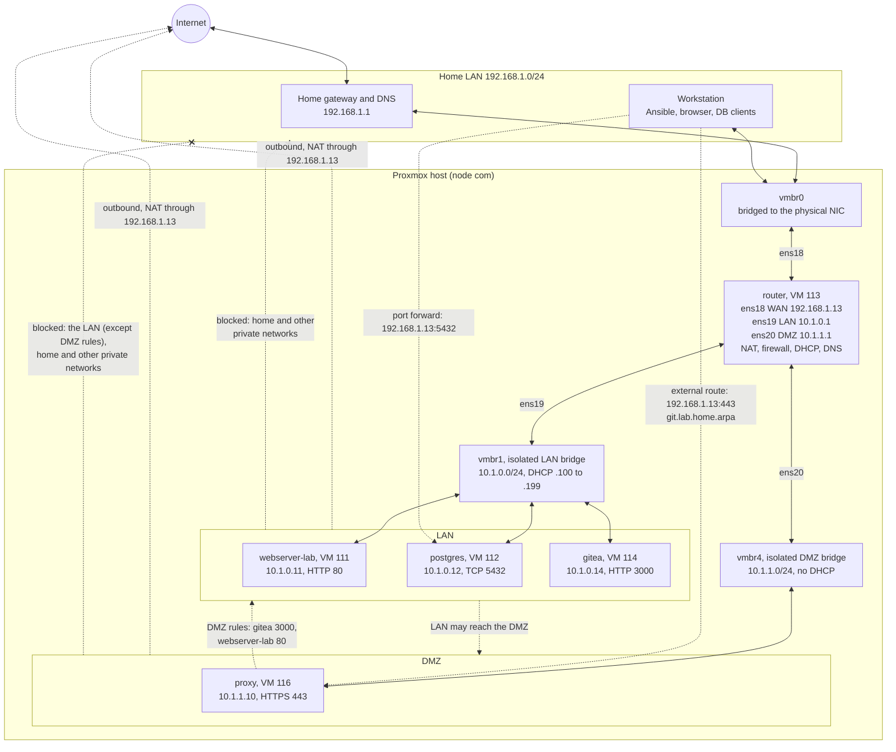

# NixOS on Proxmox

Builds whole lab networks on Proxmox from a single NixOS base image.

You describe a network in one YAML file: its subnet, its VMs and the services they run. Ansible builds it. Every VM is a clone of the same NixOS template, and what it becomes (router, database, Git server, reverse proxy) is decided entirely by the NixOS configuration the deploy installs on it. That's the point of using NixOS here:

- **The whole system is configuration.** Packages, services, users, firewall rules and network addresses are all in `.nix` files, kept in this repository. Nothing is set up by hand on a VM, so there's nothing to forget when you rebuild one.
- **Changes are atomic.** `nixos-rebuild switch` moves a VM to its new configuration in one step, or not at all, and the previous version is kept for rollback.
- **One base image fits every role.** The template only carries the common basics. A deploy turns a clone into any host type, and turns an existing VM into a new version of itself the same way.
- **Redeploying is safe.** Running a deploy again converges each VM on what its file says, so the same command creates, updates and repairs.

On top of that, the project manages the parts that make a network:

- **Isolated networks:** a Proxmox bridge with no physical port, behind a NixOS router VM that does NAT, the firewall, DHCP and DNS. The lab reaches the internet but not your home LAN.
- **A DMZ:** an optional second bridge behind the same router for published hosts, such as the reverse proxy. If one of them is taken over, it still can't reach the rest of the lab, apart from the specific ports the configuration allows.
- **Ways in from home**, from narrowest to widest: port forwards, published HTTPS routes through a Caddy reverse proxy, and a WireGuard VPN.
- **Services:** PostgreSQL, Gitea, Garage (S3), LDAP, NATS with JetStream, and nginx, each a host type with its own role.
- **Checks:** files are validated before anything changes, and every deploy ends by testing the network: addresses, DNS, internet access, isolation and DMZ rules.

The design and its decisions are in [docs/ARCHITECTURE.md](docs/ARCHITECTURE.md).

## Quickstart

You need a Proxmox host, and Docker and [uv](https://docs.astral.sh/uv/) on your workstation. Each step links to the section with the details.

1. **Install Ansible and make the SSH keys** ([Prerequisites](#prerequisites)):

   ```bash
   uv venv .venv
   uv pip install --python .venv/bin/python ansible proxmoxer requests requests_toolbelt netaddr
   .venv/bin/ansible-galaxy collection install community.proxmox community.general ansible.posix ansible.utils
   ssh-keygen -t ed25519 -f ~/.ssh/nixos-installer
   ssh-keygen -t ed25519 -f ~/.ssh/nixos-deployment
   ```

2. **Point it at Proxmox.** Create an API token (see [Prerequisites](#prerequisites)), put it and the key paths in `proxmox/.env` ([Configuration](#configuration)), and check the host, node and addresses in `proxmox/vars.yaml`.

3. **Build the template**, VM 110 ([Building the template](#building-the-template)):

   ```bash
   ./bootstrap.sh
   ```

4. **Describe a network.** The example is an isolated network with a router, a web server on its LAN, and a reverse proxy in its DMZ. Copy it, and set the router's `wan_ip` to a free address on your home LAN:

   ```bash
   cp networks/examples/test.yaml networks/test.yaml
   ```

5. **Check it and deploy it** ([Deploying VMs](#deploying-vms-from-the-template)):

   ```bash
   source proxmox/.env
   ansible-playbook playbooks/validate-network.yaml
   ansible-playbook playbooks/deploy-network.yaml -e network=test
   ```

   This creates the bridges, the router, then each VM, and ends with the network checks.

6. **Open the site.** Point the name at the router's `wan_ip` in `/etc/hosts`, then browse to `https://web.test.home.arpa/`. To avoid the browser's certificate warning, trust `secrets/test/test-proxy-ca.crt`.

   ```text
   192.168.1.20  web.test.home.arpa
   ```

7. **Remove it** when you're done, including its bridges:

   ```bash
   ansible-playbook playbooks/destroy-network.yaml -e network=test -e remove_bridge=true
   rm networks/test.yaml
   ```

To build your own network, start from [networks/README.md](networks/README.md), which describes every setting.

## Repository layout

| Path                         | Purpose                                                       |
| ---------------------------- | ------------------------------------------------------------- |
| `bootstrap.sh`               | Builds the ISO and creates the template, end to end           |
| `flake.nix`                  | Nix definitions, including the installer ISO                  |
| `installer/configuration.nix`| The installer ISO's NixOS configuration                       |
| `modules/common.nix`         | Base configuration shared by the template and every VM        |
| `proxmox/vars.yaml`          | Proxmox host, VM size, IPs and other bootstrap settings       |
| `proxmox/bootstrap.yaml`     | Runs the three template playbooks below in order              |
| `proxmox/scripts/`           | `upload-iso.yaml`, `create-template.yaml`, `install-nix.yaml`, and `isolated-bridge.yaml` for the isolated network |
| `ansible.cfg`                | Ansible settings. Run playbooks from the repository root so it is used |
| `networks/`                  | One file per network and the VMs on it. See [networks/README.md](networks/README.md) |
| `playbooks/validate-network.yaml` | Checks the network files, and checks them against Proxmox |
| `plugins/filter/`, `tests/`  | Network file checks and their tests: `.venv/bin/python -m unittest discover -s tests` |
| `roles/`                     | One role per host type (its NixOS configuration and service setup), plus shared roles: creating and removing VMs, reading the network files, finding a VM and switching it to its network |
| `playbooks/`                 | `deploy-network.yaml`, `deploy-host.yaml`, `destroy-network.yaml`, `destroy-host.yaml`, `validate-network.yaml` and `postgres-users.yaml` |
| `secrets/`                   | Host passwords and keys, gitignored. See [secrets/README.md](secrets/README.md) |
| `docs/`                      | [ARCHITECTURE.md](docs/ARCHITECTURE.md), the design and its decisions, and [plans/](docs/plans/) for changes to it |
| `Dockerfile`, `start_container.sh` | Nix build container                                     |

## Prerequisites

On the workstation:

- **Docker**, to build the ISO. Nix is not needed on the workstation.
- **Ansible** with the Proxmox modules. The bootstrap uses `.venv/` if it exists, and the other playbooks should be run with it too:

  ```bash
  uv venv .venv
  uv pip install --python .venv/bin/python ansible proxmoxer requests requests_toolbelt netaddr
  .venv/bin/ansible-galaxy collection install community.proxmox community.general ansible.posix ansible.utils
  ```

- **Two SSH key pairs**, kept on the workstation:

  ```bash
  ssh-keygen -t ed25519 -f ~/.ssh/nixos-installer    # logs in as root on the installer ISO
  ssh-keygen -t ed25519 -f ~/.ssh/nixos-deployment   # logs in as admin on installed systems
  ```

  Only the public keys go into the ISO and the installed systems. Never put a private key in the repository, the ISO or the Docker image.

On Proxmox:

- An API token for `ansible@pve` with the ID `automation`, allowed to manage VMs and upload ISOs to the `local` storage. Setting VM tags and notes uses `VM.Config.Options`, which managing VMs normally includes. Creating or removing an isolated bridge also needs `Sys.Modify` on `/nodes/com`.

## Configuration

`bootstrap.sh` reads these variables from the environment, or from `proxmox/.env` if it exists (`.env` is gitignored):

```bash
export PROXMOX_TOKEN_SECRET='<api token secret>'
export NIXOS_INSTALLER_KEY="$HOME/.ssh/nixos-installer"
export NIXOS_INSTALLER_PUBLIC_KEY="$HOME/.ssh/nixos-installer.pub"
export NIXOS_DEPLOYMENT_PUBLIC_KEY="$HOME/.ssh/nixos-deployment.pub"
export NIXOS_DEPLOYMENT_PRIVATE_KEY="$HOME/.ssh/nixos-deployment"
```

The key variables are file paths. The Proxmox host, node, VM ID, IPs, VM size and storage names are in `proxmox/vars.yaml`.

## Building the template

```bash
./bootstrap.sh
```

The script stops at the first failure. In order, it:

1. Checks that Docker, Ansible, the Ansible collections, the variables above and the key files are all present.
2. Builds the `nixos-lab` Docker image.
3. Builds the installer ISO in the container and copies it to `build/nixos-installer-<hash>.iso`. The hash comes from the Nix build, so a changed configuration or key gives a new name.
4. Uploads the ISO to Proxmox. The upload is skipped if an ISO with that name is already there.
5. Creates VM 110 with the ISO attached and boots it into the installer.
6. Waits for the installer's SSH, then over SSH:
   - partitions `/dev/sda` with a BIOS boot partition and an ext4 root partition
   - generates `hardware-configuration.nix`
   - installs `modules/common.nix` and a `configuration.nix` holding the static IP
   - runs `nixos-install`
7. Stops the VM, detaches the ISO and boots the installed system.
8. Logs in as `admin` with the deployment key. Only the installed system has that user, so this proves the VM booted from its disk and not the ISO.
9. Shuts the VM down and converts it into a template.

### Options

```bash
./bootstrap.sh --force     # destroy VM 110 first if it already exists
./bootstrap.sh -- -vv      # pass extra arguments to ansible-playbook
```

Without `--force`, the script refuses to touch an existing VM 110. Proxmox will not delete a template that still has linked clones, such as the webserver, so remove those clones before using `--force`.

### Running a single stage

Each playbook in `proxmox/scripts/` can run on its own once an ISO is built. Pass the ISO path:

```bash
ansible-playbook proxmox/scripts/install-nix.yaml -e installer_iso="$PWD/build/nixos-installer-<hash>.iso"
```

## Deploying VMs from the template

Each network is described by a file in [networks/](networks/README.md): its bridge, subnet and gateway, and the VMs on it. Today there are two:

- [networks/home.yaml](networks/home.yaml): a webserver (and garage, commented out), directly on the home LAN.
- [networks/lab.yaml](networks/lab.yaml): an isolated network. The router, postgres, gitea and a second webserver are on its LAN, and the reverse proxy is in its DMZ.

[networks/examples/test.yaml](networks/examples/test.yaml) is a small throwaway network, used in the [Quickstart](#quickstart).

Check the files, then deploy a whole network, or one host:

```bash
source proxmox/.env
ansible-playbook playbooks/validate-network.yaml
ansible-playbook playbooks/deploy-network.yaml -e network=lab
ansible-playbook playbooks/deploy-host.yaml -e network=lab -e host=postgres
```

`deploy-network.yaml` deploys the network's hosts one at a time. On an isolated network the router goes first, then the rest in file order, and the run stops at the first host that fails. The router's deploy creates the network's bridges (the LAN's and the DMZ's) if they don't exist yet.

Once every host is deployed, it [checks the whole network](roles/network_verify/README.md): addresses, gateways, DNS, internet access, that isolated hosts can't reach the home LAN, that DMZ hosts reach the LAN only where allowed, that nothing unexpected is listening or forwarded, and that proxy routes answer. It reports every problem at once. To run only the checks:

```bash
ansible-playbook playbooks/verify-network.yaml -e network=lab
```

### Which VMs are the project's

Every deploy tags its VM in Proxmox with `nixlab`, `net-<network>` and `type-<type>`. Other tags you add are kept. The playbooks only ever delete VMs carrying `nixlab` and the right `net-` tag, so VMs this project didn't make are safe even if their ID or name is in a file by mistake.

Before deploying, `deploy-network.yaml` (and `validate-network.yaml`) report:

- **Removed from the file:** VMs tagged for the network that no network file lists any more. They're left running unless you prune:

  ```bash
  ansible-playbook playbooks/deploy-network.yaml -e network=lab -e prune=true
  ```

  This asks you to type the network name (or takes `-e confirm_prune=lab`), deletes them, routers last, and then deploys. If a removed VM still holds an address that the file gives another host, the deploy stops until you prune or change the address.
- **Moved:** VMs tagged for this network but now listed in another network's file. They move when you deploy that network, and are never pruned.
- **Not yet tagged:** VMs deployed before tagging existed. Their next deploy tags them. Until then, nothing deletes them.

To delete a whole network, routers last, and optionally its bridge once no VM uses it:

```bash
ansible-playbook playbooks/destroy-network.yaml -e network=lab -e remove_bridge=true
```

It asks you to type the network name. The network file stays, so deploying it again recreates everything.

The deploy:

1. Checks every network file and compares them with Proxmox.
2. Clones the template if the VM doesn't exist, and adds its data disk and network cards.
3. Finds the VM. A new clone boots on the template's IP. An existing VM is found at the address its last deploy recorded in its Proxmox notes.
4. Checks that the VM's MAC address matches Proxmox's before changing anything.
5. Installs its NixOS configuration and runs `nixos-rebuild switch`, which moves it to its own IP.
6. Records the new address in its Proxmox notes, as `nixlab-address: <ip> on <bridge>`, then checks that its service answers. On an isolated network it also records the VM's DNS name, as `nixlab-dns: postgres.lab.home.arpa`. That name only works from VMs on that network. Other lines in the notes are kept.

Running it again on an existing VM updates it in place. VMs on an isolated network are reached over SSH through that network's router, so deploy the router first.

Each host type is a role in [roles/](roles/), with a README that explains its settings:

- [webserver](roles/webserver/README.md): nginx serving static files
- [postgres](roles/postgres/README.md): PostgreSQL on a separate data disk, with optional AdventureWorks sample data. [Database users](roles/postgres/USERS.md) are set up on deploy; `playbooks/postgres-users.yaml` applies changes to them alone.
- [gitea](roles/gitea/README.md): Gitea Git server on a separate data disk
- [garage](roles/garage/README.md): Garage S3-compatible object storage on a separate data disk
- [router](roles/router/README.md): connects an isolated bridge (and its DMZ) to the internet with DHCP, NAT and a firewall that blocks the home LAN
- [proxy](roles/proxy/README.md): Caddy reverse proxy that serves other hosts' web services under HTTPS names, built from their `proxy:` entries
- [ldap](roles/ldap/README.md): lldap, a small LDAP server for user accounts and groups, with a web interface
- [nats](roles/nats/README.md): NATS messaging server with JetStream persistence on a separate data disk

Passwords and keys for hosts go in `secrets/<network>/<host>.env`; see [secrets/README.md](secrets/README.md).

To delete a host's VM and all its disks (it asks you to type the name):

```bash
ansible-playbook playbooks/destroy-host.yaml -e network=lab -e host=postgres
```

Remove its entry from the network file too, or the next deploy creates it again. A router can't be deleted while VMs of its network still exist, and only VMs tagged as the project's are deleted.

## Network addressing

Static addresses must stay outside the home router's DHCP pool. Validation checks that no two hosts share an address, and that no host uses the template's address or a network's gateway.

| IP             | System                                                    |
| -------------- | --------------------------------------------------------- |
| `192.168.1.1`  | gateway and DNS                                           |
| `192.168.1.10` | Installer ISO and the template, on VM 110 (never at the same time). New clones also boot here first. |
| `192.168.1.11` | webserver (VM 150)                                        |
| `192.168.1.13` | router (VM 113), WAN side: port forwards, and the proxy's external routes |
| `192.168.1.15` | garage (VM 115), commented out in `home.yaml`             |

Because every new clone starts on `.10`, the deploy works on one VM at a time.

### Isolated network

`vmbr1` is a bridge with no physical port and no IP on the Proxmox host. Deploying the router creates it if it's missing, and `proxmox/scripts/isolated-bridge.yaml -e bridge=<name>` can create one on its own. The [router](roles/router/README.md) is its only way out:

| IP                          | System                                     |
| --------------------------- | ------------------------------------------ |
| `10.1.0.1`                  | router (VM 113), LAN side: gateway and DNS |
| `10.1.0.11`                 | webserver-lab (VM 111)                     |
| `10.1.0.12`                 | postgres (VM 112)                          |
| `10.1.0.14`                 | gitea (VM 114)                             |
| `10.1.0.100` – `10.1.0.199` | DHCP pool                                  |

VMs on `vmbr1` reach the internet but not `192.168.1.0/24` or other private networks. From home, they're reachable only through port forwards on the router, made from each host's `expose:` entries in `networks/lab.yaml`. The router's DNS server answers for the network's hosts, as `postgres` or `postgres.lab.home.arpa`.

### DMZ

`lab` also has a DMZ: `vmbr4`, a second isolated bridge on the router's third card. Published hosts go there, so that one that is taken over can't reach the rest of the lab. A host joins it with `zone: dmz` in the network file. See [networks/README.md](networks/README.md#dmz) for the settings.

| IP          | System                                       |
| ----------- | -------------------------------------------- |
| `10.1.1.1`  | router (VM 113), DMZ side: gateway and DNS   |
| `10.1.1.10` | proxy (VM 116): `git` (external), `www`      |

The DMZ has no DHCP, so a VM attached to `vmbr4` by hand gets no address.

| From → to | LAN | DMZ | Home / private networks | Internet |
|---|---|---|---|---|
| LAN | yes | yes | no | yes |
| DMZ | only DMZ rules | yes | no | yes |
| VPN | yes | yes | no | no |
| Home | port forwards | port forwards and external routes | | |

**DMZ rules** are the router's only openings from the DMZ into the LAN. Each lets one DMZ host reach one LAN host on one port. They're worked out from the files: when the proxy is in the DMZ, it may reach each route's backend on the route's port. In `lab` that's gitea on 3000 and webserver-lab on 80, and nothing else. Anything more is listed under the DMZ host's `reach:`.

Validation warns, without stopping, about published hosts left on the LAN of a network with a DMZ. In `lab`, that's postgres, whose port 5432 is forwarded from home.

### Reaching lab services from home

There are three ways in, from narrowest to widest:

| Way | What it reaches | Set up with |
|---|---|---|
| Port forward | One port on one host, at `192.168.1.13:<wan_port>`, such as postgres on 5432 | `expose:` on the host |
| External proxy route | One web service by name, such as `https://git.lab.home.arpa/`, through the router's 443 and 80 to the proxy in the DMZ | `external: true` on the host's `proxy:` entry |
| [VPN](roles/router/README.md#vpn) | Every host on the LAN and the DMZ, and every proxy route, with the lab's DNS | `vpn:` in the router's settings |

Proxy routes are picked by name, so `https://192.168.1.13/` doesn't work. Home machines ask the home router for names, not the lab router, so point each external route's name at `192.168.1.13`. Either set this on your home router for every machine, or in `/etc/hosts` for just your machine. One line can hold several names:

```text
192.168.1.13  git.lab.home.arpa  other.lab.home.arpa
```

Only names of external routes work this way. Internal routes, like `www`, refuse connections from home addresses, and from DMZ hosts; use the VPN for those. VPN clients use the lab router's DNS, so they need no overrides. Either way, trust the proxy's certificate, `secrets/lab/proxy-ca.crt`, to avoid browser warnings (see [roles/proxy](roles/proxy/README.md#https)).

### Example: the lab network



Solid lines are the physical and virtual links. Dashed lines are what the router's firewall allows or blocks, all of it enforced on the router. The router's own SSH is reachable only from the home side and the VPN. The LAN and the DMZ can only use DHCP, DNS and ping on the router.

## Moving a VM between networks

Move the host's entry from one network file to the other, give it an address in its new network, and deploy it:

```bash
ansible-playbook playbooks/deploy-host.yaml -e network=lab -e host=gitea
```

The deploy finds the VM at the address it recorded last time, changes its address and moves its network card (net0) to the new bridge. Proxmox does that while the VM runs, and the VM keeps its MAC address and disks. The router must be deployed before anything moves onto an isolated network.

If a move is interrupted, run it again. The deploy also looks for the VM at its new address and on the other bridge, moving the card if needed, and finishes the move from wherever the VM is.

To SSH to an isolated VM by hand, add this to `~/.ssh/config`:

```
Host 192.168.1.13 10.1.0.* 10.1.1.*
  User admin
  IdentityFile ~/.ssh/nixos-deployment

Host 10.1.0.* 10.1.1.*
  ProxyJump 192.168.1.13
```

Then `ssh 10.1.0.12`, or `ssh 10.1.1.10` for the proxy in the DMZ, goes through the router.

A host moves between the LAN and the DMZ the same way: change its `zone` and `ip`, and deploy the network. The router goes first and gets the new DMZ rules, then the host's card moves to the other bridge.

## Notes

### SSH host keys

The installer ISO and the installed template both answer on `192.168.1.10` but have different SSH host keys. `bootstrap.sh` removes the `.10` entry from `~/.ssh/known_hosts` before each switch, then accepts the new key on first connect. Clones keep the template's host keys.

If a manual SSH connection reports `REMOTE HOST IDENTIFICATION HAS CHANGED` after a rebuild, remove the old entry:

```bash
ssh-keygen -f ~/.ssh/known_hosts -R 192.168.1.10
```

### The installer key is read at build time

`installer/configuration.nix` reads the installer's public key from the `NIXOS_INSTALLER_AUTHORIZED_KEY` environment variable. `bootstrap.sh` fills it from the file in `NIXOS_INSTALLER_PUBLIC_KEY`. Reading the environment from a flake requires `--impure`, so a plain `nix build` or `nix flake check` of the installer fails with an assertion asking for the key.

### `HOME=/root` for `nixos-install`

The `nixos-install` task sets `HOME=/root`. Without it, the command fails under Ansible with misleading hostname-resolution errors, even though it works when run interactively and the installer can reach `cache.nixos.org`.

### Build container

To work in the Nix container by hand:

```bash
./start_container.sh
nix build --impure .#nixosConfigurations.installer.config.system.build.isoImage
```

`bootstrap.sh` keeps the container's Nix store in a Docker volume named `nixos-lab-nix-<image id>`, so later builds reuse downloads. A new volume is created whenever the image changes. Clear out old ones with `docker volume prune`.
