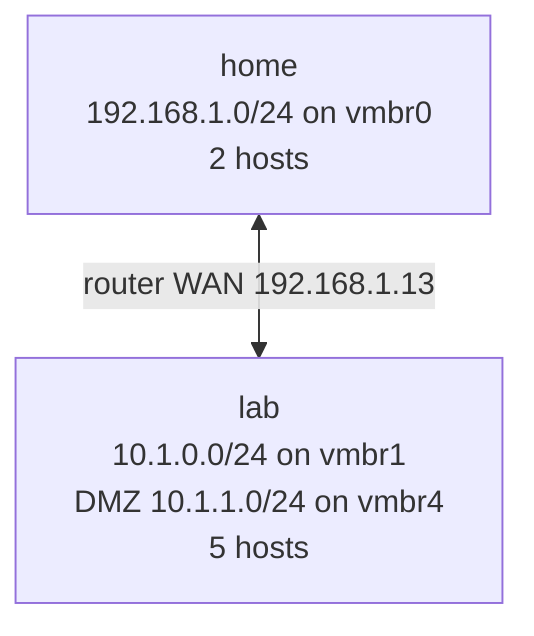

# Network diagrams

One file per network, written when the network is deployed or changed. Don't edit them: redeploy, or run `playbooks/diagram-network.yaml`, to update them.

| Network | Type | Subnet | Bridge | Router WAN | Hosts deployed |
|---|---|---|---|---|---|
| [home](home.md) | home | 192.168.1.0/24 | vmbr0 | — | 2 of 2 |
| [lab](lab.md) | isolated | 10.1.0.0/24 | vmbr1 | 192.168.1.13 | 5 of 5 |

