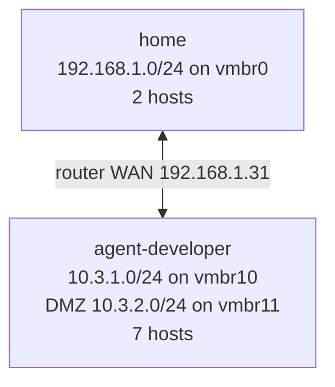

# Network diagrams

One file per network, written when the network is deployed or changed. Don't edit them: redeploy, or run `playbooks/diagram-network.yaml`, to update them.

| Network | Type | Subnet | Bridge | Router WAN | Hosts deployed |
|---|---|---|---|---|---|
| [agent-developer](agent-developer.md) | isolated | 10.3.1.0/24 | vmbr10 | 192.168.1.31 | 7 of 7 |
| [home](home.md) | home | 192.168.1.0/24 | vmbr0 | — | 2 of 2 |

