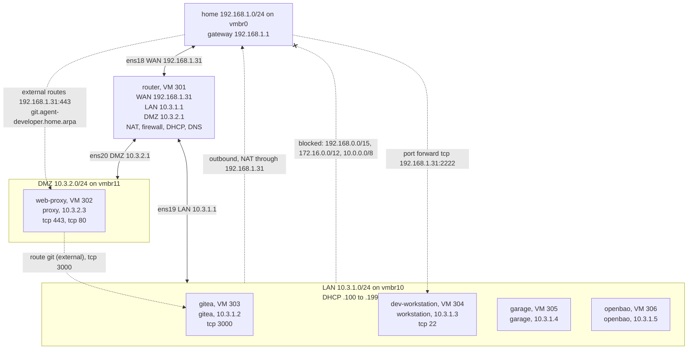

# Network agent-developer

Generated from [networks/agent-developer.yaml](../../networks/agent-developer.yaml) when the network is deployed or changed. Don't edit it: redeploy, or run `playbooks/diagram-network.yaml`, to update it.

Isolated network 10.3.1.0/24 on vmbr10, behind router on home at 192.168.1.31. DNS domain agent-developer.home.arpa. 6 of 6 hosts deployed.

## Hosts

| Host | Type | VM ID | Zone | Address | Ports | Data disk | Deployed |
|---|---|---|---|---|---|---|---|
| router | router | 301 | router | 192.168.1.31 (LAN 10.3.1.1) | — | — | yes |
| web-proxy | proxy | 302 | dmz | 10.3.2.3 | tcp 443, tcp 80 | — | yes |
| gitea | gitea | 303 | lan | 10.3.1.2 | tcp 3000 | 40 GB on local-lvm | yes |
| dev-workstation | workstation | 304 | lan | 10.3.1.3 | tcp 22 | — | yes |
| garage | garage | 305 | lan | 10.3.1.4 | — | 20 GB on local-lvm | yes |
| openbao | openbao | 306 | lan | 10.3.1.5 | — | 10 GB on local-lvm | yes |

## Port forwards

From the router's WAN address, 192.168.1.31.

| Name | Protocol | WAN port | To |
|---|---|---|---|
| dev-workstation | tcp | 2222 | dev-workstation 10.3.1.3:22 |
| web-proxy-https | tcp | 443 | web-proxy 10.3.2.3:443 |
| web-proxy-http | tcp | 80 | web-proxy 10.3.2.3:80 |

## Proxy routes

Served by web-proxy.

| Route | Name | Backend | External |
|---|---|---|---|
| git | git.agent-developer.home.arpa | gitea 10.3.1.2:3000 | yes |

## DMZ to LAN rules

| From | To | Port |
|---|---|---|
| web-proxy 10.3.2.3 | gitea 10.3.1.2 | tcp 3000 |
