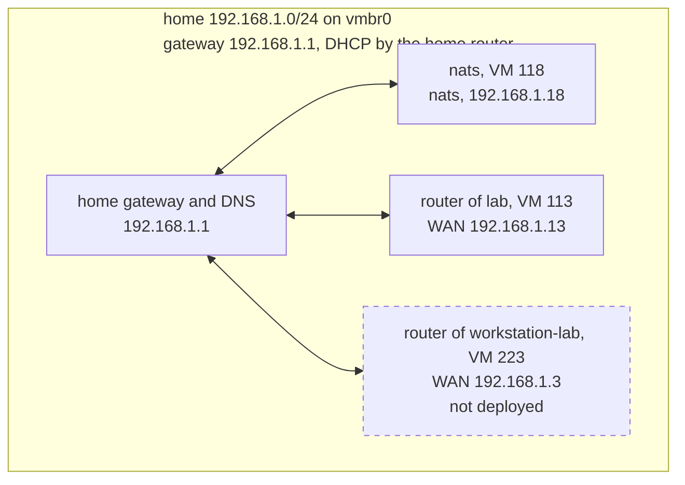

# Network home

Generated from [networks/home.yaml](../../networks/home.yaml) when the network is deployed or changed. Don't edit it: redeploy, or run `playbooks/diagram-network.yaml`, to update it.

Home network 192.168.1.0/24 on vmbr0. 1 of 1 host deployed.

## Hosts

| Host | Type | VM ID | Zone | Address | Ports | Data disk | Deployed |
|---|---|---|---|---|---|---|---|
| nats | nats | 118 | lan | 192.168.1.18 | — | 20 GB on local-lvm | yes |
