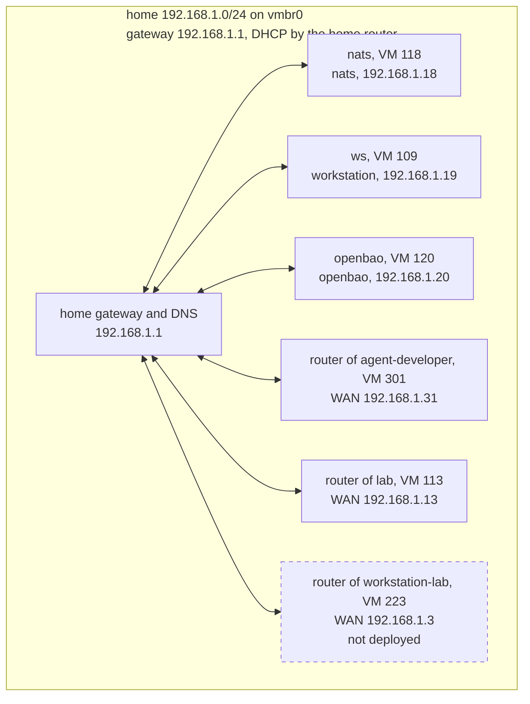

# Network home

Generated from [networks/home.yaml](../../networks/home.yaml) when the network is deployed or changed. Don't edit it: redeploy, or run `playbooks/diagram-network.yaml`, to update it.

Home network 192.168.1.0/24 on vmbr0. 3 of 3 hosts deployed.

## Hosts

| Host | Type | VM ID | Zone | Address | Ports | Data disk | Deployed |
|---|---|---|---|---|---|---|---|
| nats | nats | 118 | lan | 192.168.1.18 | — | 20 GB on local-lvm | yes |
| ws | workstation | 109 | lan | 192.168.1.19 | — | — | yes |
| openbao | openbao | 120 | lan | 192.168.1.20 | — | 10 GB on local-lvm | yes |

## Software

Packages and tools declared in the network file. Each role's README lists what the role installs itself.

| Host | Packages | Tools |
|---|---|---|
| ws | python3Packages.ipython, uv, nodejs_22 | @anthropic-ai/claude-code (npm), ruff@0.8.4 (uv) |
