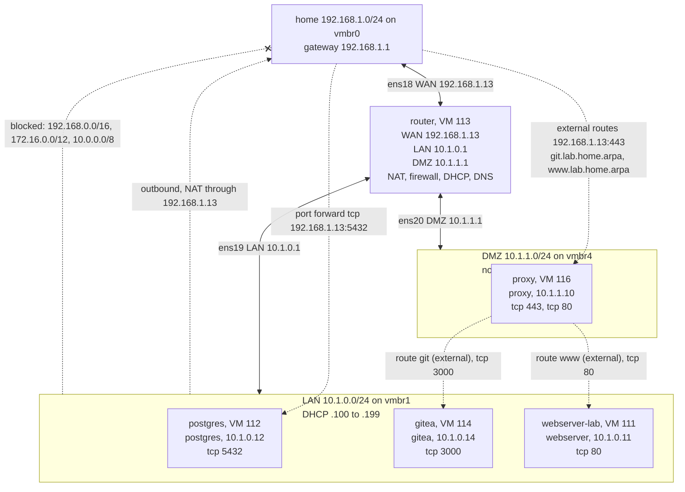

# Network lab

Generated from [networks/lab.yaml](../../networks/lab.yaml) when the network is deployed or changed. Don't edit it: redeploy, or run `playbooks/diagram-network.yaml`, to update it.

Isolated network 10.1.0.0/24 on vmbr1, behind router on home at 192.168.1.13. DNS domain lab.home.arpa. 5 of 5 hosts deployed.

## Hosts

| Host | Type | VM ID | Zone | Address | Ports | Data disk | Deployed |
|---|---|---|---|---|---|---|---|
| router | router | 113 | router | 192.168.1.13 (LAN 10.1.0.1) | — | — | yes |
| postgres | postgres | 112 | lan | 10.1.0.12 | tcp 5432 | 20 GB on local-lvm | yes |
| proxy | proxy | 116 | dmz | 10.1.1.10 | tcp 443, tcp 80 | — | yes |
| gitea | gitea | 114 | lan | 10.1.0.14 | tcp 3000 | 40 GB on local-lvm | yes |
| webserver-lab | webserver | 111 | lan | 10.1.0.11 | tcp 80 | — | yes |

## Port forwards

From the router's WAN address, 192.168.1.13.

| Name | Protocol | WAN port | To |
|---|---|---|---|
| postgres | tcp | 5432 | postgres 10.1.0.12:5432 |
| proxy-https | tcp | 443 | proxy 10.1.1.10:443 |
| proxy-http | tcp | 80 | proxy 10.1.1.10:80 |

## Proxy routes

Served by proxy.

| Route | Name | Backend | External |
|---|---|---|---|
| git | git.lab.home.arpa | gitea 10.1.0.14:3000 | yes |
| www | www.lab.home.arpa | webserver-lab 10.1.0.11:80 | yes |

## DMZ to LAN rules

| From | To | Port |
|---|---|---|
| proxy 10.1.1.10 | gitea 10.1.0.14 | tcp 3000 |
| proxy 10.1.1.10 | webserver-lab 10.1.0.11 | tcp 80 |
