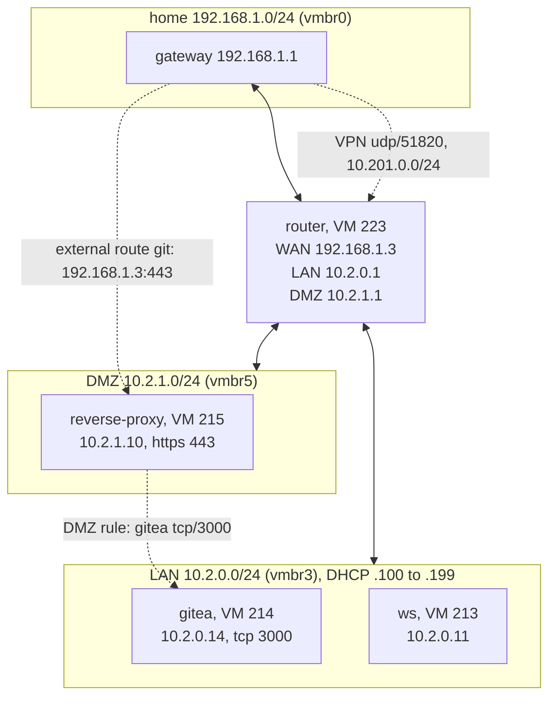

# Plan: network diagrams written on deploy

Every playbook that deploys or changes a network writes a diagram of it to `docs/network-diagrams/<network>.md`. The diagram is made from the same inventory the deploy uses (`network_config_inventory`), so it shows what was just deployed: bridges, the router and its addresses, hosts by zone, and the paths in and out. Nothing is drawn by hand, and a diagram can't drift from the files without a deploy.

Today the only diagram is the hand-written one of `lab` in the [README](../../../README.md#network-diagrams). It is already out of date with `workstation-lab` deployed beside it.

## Progress

**All phases are done (2026-11-08, tested live).** The decisions in section 3 were taken as recommended.

Live (2026-11-08):

- `diagram-network.yaml` with Proxmox redrew every diagram from the real VM list. `workstation-lab` had no VMs, so all four of its hosts showed as not deployed, and so did its router on `home.md`.
- **Step 1:** `deploy-network.yaml -e network=lab` passed every check. The diagram task reported `ok`, and `lab.md` and `home.md` were byte-for-byte unchanged.
- **Step 2,** run on `workstation-lab` as the throwaway network: `deploy-host.yaml -e network=workstation-lab -e host=router` created VM 223. Then `workstation-lab.md` showed 1 of 4 hosts deployed, `home.md` stopped marking that router not deployed, and `lab.md` didn't change.
- **Step 3:** the router was destroyed and `destroy-network.yaml` removed `workstation-lab.md` and its index line. `home.md` marks that network's router not deployed.
- **Fixes after the live check:**
  - Running `diagram-network.yaml` for every network brought back the diagram `destroy-network.yaml` had just deleted. Without `-e network`, it now leaves out networks with no VMs in Proxmox (`networks_with_deployed_hosts`). Naming one with `-e network` still draws it.
  - The routers on `home.md` no longer say "see <network>.md", which pointed at a missing file once that network was destroyed. The index links each network instead.
- The diagrams render in VS Code's Markdown preview.

Checked without Proxmox:

- 16 new tests in [tests/test_diagram.py](../../../tests/test_diagram.py) pass, with golden files in [tests/fixtures/diagrams/](../../../tests/fixtures/diagrams/). The whole suite is 195 of 196. The one failure is the old overlap of `networks/examples/test.yaml` with `workstation-lab`.
- `--syntax-check` passes on every playbook.
- `diagram-network.yaml -e network_config_check_proxmox=false` wrote all four files, and a second run changed nothing.
- There is no Mermaid CLI here, so rendering was checked by eye in VS Code (see above).

Differences from the plan below:

- **The filters are in their own file,** [plugins/filter/network_diagram.py](../../../plugins/filter/network_diagram.py), not in `network_config.py`.
- **The header doesn't name the playbook.** Otherwise a file would change whenever a different playbook rewrote the same diagram.
- **The deployed set comes from Proxmox after the run.** `diagram.yml` reads the VM list again once the deploy or destroy is done, so it doesn't track added and deleted hosts itself. A host counts as deployed when a VM with its ID and name exists.
- **The upstream network is redrawn too.** A home network's diagram shows the routers of the isolated networks on it, marked "not deployed" when they are missing. So deploying or destroying `lab` also rewrites `home.md`.
- **`destroy-network.yaml`** deletes the network's diagram, but its file stays in `networks/`. Deploying it again draws it again.

## 1. Target

```text
docs/network-diagrams/
  README.md              index: one line per network, plus an overview of all networks
  home.md                one file per network file in networks/
  lab.md
  workstation-lab.md
```

Each network's file holds:

1. **A Mermaid flowchart.** It covers:
   - The upstream network and the router: VM ID, WAN, LAN and DMZ addresses.
   - Each bridge, with its subnet and DHCP range.
   - The hosts in a LAN and a DMZ subgraph, each with its VM ID, address and service ports.
   - Dashed edges for port forwards, external proxy routes, DMZ → LAN rules, the VPN, outbound NAT and what is blocked.
2. **Tables** for the same data, readable without a Mermaid renderer:
   - hosts (name, type, VM ID, zone, IP, data disk)
   - port forwards
   - proxy routes
   - DMZ rules
   - VPN peers (name and address only)
3. A header line: `Generated from networks/<network>.yaml by <playbook>. Don't edit; redeploy to update.`

For example, the start of `workstation-lab.md`:

````markdown
# Network workstation-lab

Generated from networks/workstation-lab.yaml by deploy-network.yaml. Don't edit; redeploy to update.


````

## 2. What exists and what has to change

| Piece | Today | Change |
|---|---|---|
| [network_config.py](../../../plugins/filter/network_config.py) `network_config_inventory` | Has everything a diagram needs: bridges, `dmz`, `router_wan_ip`, `port_forwards`, `proxy_routes`, `dmz_rules`, `vpn`, hosts with `attach`, `zone`, `vm_id` | No change. |
| New filter `network_diagram(inventory, network, deployed_ids, source)` | — | Returns the Markdown for one network as a string. Pure Python, so it can be unit-tested. Node IDs are made from host names (`h_<name>` with `-` → `_`). Labels are escaped for Mermaid (`"`, `<`, `>`, `#`). Hosts are listed in file order, so the output is the same on every run. |
| New filter `network_diagram_index(inventory, deployed_networks)` | — | Returns `README.md`: links to each network's file, and one small flowchart of the home LAN with each isolated network's router hanging off it. |
| New task file `roles/network_config/tasks/diagram.yml` | — | Runs on localhost. Writes `docs/network-diagrams/<network>.md` and the index with `ansible.builtin.copy` (`content:`). Writes only when the text changed, so a redeploy with no changes leaves git clean. |
| [deploy-network.yaml](../../../playbooks/deploy-network.yaml) | Deploys, checks, reports | Writes the diagram after the hosts are deployed, before the checks. A failed check still leaves an accurate diagram; a failed deploy writes none. |
| [deploy-host.yaml](../../../playbooks/deploy-host.yaml) | Deploys one host | Writes the diagram of that host's network once it has deployed. A host moved here from another network also rewrites the old network's diagram. |
| [destroy-host.yaml](../../../playbooks/destroy-host.yaml) | Deletes one VM | Rewrites the network's diagram, with that host shown as not deployed. |
| [destroy-network.yaml](../../../playbooks/destroy-network.yaml) | Deletes every VM of a network | Deletes `<network>.md` and rewrites the index. |
| New playbook `playbooks/diagram-network.yaml` | — | Rewrites every diagram, or one with `-e network=`, without deploying. Works offline with `-e network_config_check_proxmox=false`. In that case every declared host counts as deployed. |
| [README.md](../../../README.md#network-diagrams) | Hand-written lab diagram | Replace with a link to `docs/network-diagrams/` (decision 4). |

**Deployed or only declared.** A network file can list hosts that were never deployed, for example after `deploy-host` for one host of a new network. The diagram draws those with a dashed outline and "not deployed". The deployed set is:

- the VMs that `network_config` read from Proxmox at the start of the run,
- plus the hosts this run deployed,
- minus the ones it deleted.

## 3. Decisions needing approval

| # | Decision | Recommended | Alternative |
|---|---|---|---|
| 1 | Format | **Mermaid inside Markdown.** It renders on GitHub, Gitea and in VS Code, is plain text that diffs well, and needs no new tools in the container. | Graphviz SVG: better layout, but needs `dot` in the deploy container, and SVG diffs are unreadable. D2: needs a new tool too. |
| 2 | When diagrams are written | **On successful deploys and destroys**, plus `diagram-network.yaml` on demand. Editing a network file doesn't change its diagram until the network is deployed. | Also in `validate-network.yaml`, so the diagrams follow the files even before a deploy. That mixes "planned" and "deployed" in one picture. |
| 3 | Committing | **The playbooks write the files and never commit.** You review the diff and commit it with the network file change. | Commit automatically: surprising, and the repo has no CI identity to commit as. |
| 4 | README's hand-written lab diagram | **Replace it with a link** to `docs/network-diagrams/lab.md`. Keep one short sentence on what the diagrams show. | Keep both. The hand-written one shows the Proxmox node and the internet, but it goes stale. |
| 5 | What's left out | **No secrets and no keys**: VPN peers show name and address only, never `public_key`. No passwords or `settings:` beyond ports. IPs and VM IDs are already in the network files in git, so the diagrams expose nothing new. | — |
| 6 | Checks on committed diagrams | **None in the unit tests.** Diagrams follow deploys, not files, so a test comparing them to the files would fail between an edit and its deploy. | A test that regenerates every diagram and compares. Only right if decision 2 takes the alternative. |

## 4. Phases

### Phase 1: The filters

- `network_diagram` and `network_diagram_index` in `network_config.py`.
- Tests in a new `tests/test_diagram.py`:
  - Golden output for the fixture networks (`tests/fixtures/diagrams/lab.md`).
  - A network with a DMZ and VPN.
  - A home network, with no router and no bridge subgraphs.
  - A host that isn't deployed.
  - Host names with `-` give valid node IDs, and labels are escaped.
  - Two networks with the same host names give separate files with no clash.
  - No `public_key` value appears in the output.

### Phase 2: Writing them

- `roles/network_config/tasks/diagram.yml` and `playbooks/diagram-network.yaml`.
- Run `diagram-network.yaml -e network_config_check_proxmox=false` and check the three files render in VS Code's Markdown preview and on GitHub.
- Commit the first set of diagrams.

### Phase 3: Deploy and destroy playbooks

- Hook `diagram.yml` into `deploy-network`, `deploy-host`, `destroy-host` and `destroy-network` as in section 2.
- Record the deployed set: hosts in `groups['nixlab_deploy']` that finished, and the IDs that were deleted.

### Phase 4: Docs

- [README.md](../../../README.md): replace the lab diagram (decision 4), and mention `docs/network-diagrams/` in the layout table.
- [networks/README.md](../../../networks/README.md) and [roles/README.md](../../../roles/README.md): say that deploys rewrite the diagrams. A new role's service ports show up because they come from `expose:` and `proxy:`, so a new role needs no diagram code.

### Phase 5: Live check

1. Deploy `lab`. Check that `docs/network-diagrams/lab.md` matches what Proxmox shows, and that a second deploy leaves `git status` clean.
2. Run `deploy-host` for one `workstation-lab` host after editing its port. Only `workstation-lab.md` changes.
3. On a throwaway network, run `destroy-host`, then `destroy-network`. The host shows as not deployed, then the network's file and its index line are removed.

## 5. Risks

- **Files written during a deploy.** The playbooks start to change the working tree, not only Proxmox. They write only under `docs/network-diagrams/`, only after a successful step, and never commit.
- **A diagram that looks right but isn't.** The diagram shows the files as deployed. Anything changed by hand in Proxmox isn't shown; `verify-network.yaml` remains the check for that. The header line says where the diagram comes from.
- **Mermaid layout on big networks.** Many hosts and dashed edges can get cluttered. The tables carry the same data, so the diagram can stay simple. Edges can be grouped (one DMZ-rules edge per DMZ host, as in the README today) if it gets crowded.
- **Running from the container.** `docs/` must be writable from where Ansible runs. [start_container.sh](../../../start_container.sh) mounts the repo read-write at `/workspace`, so it is. Files are written as the container's user, which has the host user's UID.
