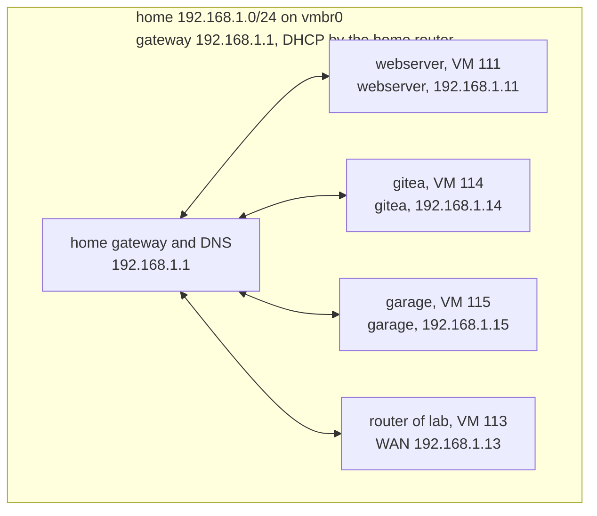

# Network home

Generated from [networks/home.yaml](../../networks/home.yaml) when the network is deployed or changed. Don't edit it: redeploy, or run `playbooks/diagram-network.yaml`, to update it.

Home network 192.168.1.0/24 on vmbr0. 3 of 3 hosts deployed.

## Hosts

| Host | Type | VM ID | Zone | Address | Ports | Data disk | Deployed |
|---|---|---|---|---|---|---|---|
| webserver | webserver | 111 | lan | 192.168.1.11 | — | — | yes |
| gitea | gitea | 114 | lan | 192.168.1.14 | — | 40 GB on local-lvm | yes |
| garage | garage | 115 | lan | 192.168.1.15 | — | 128 GB on local-lvm | yes |
